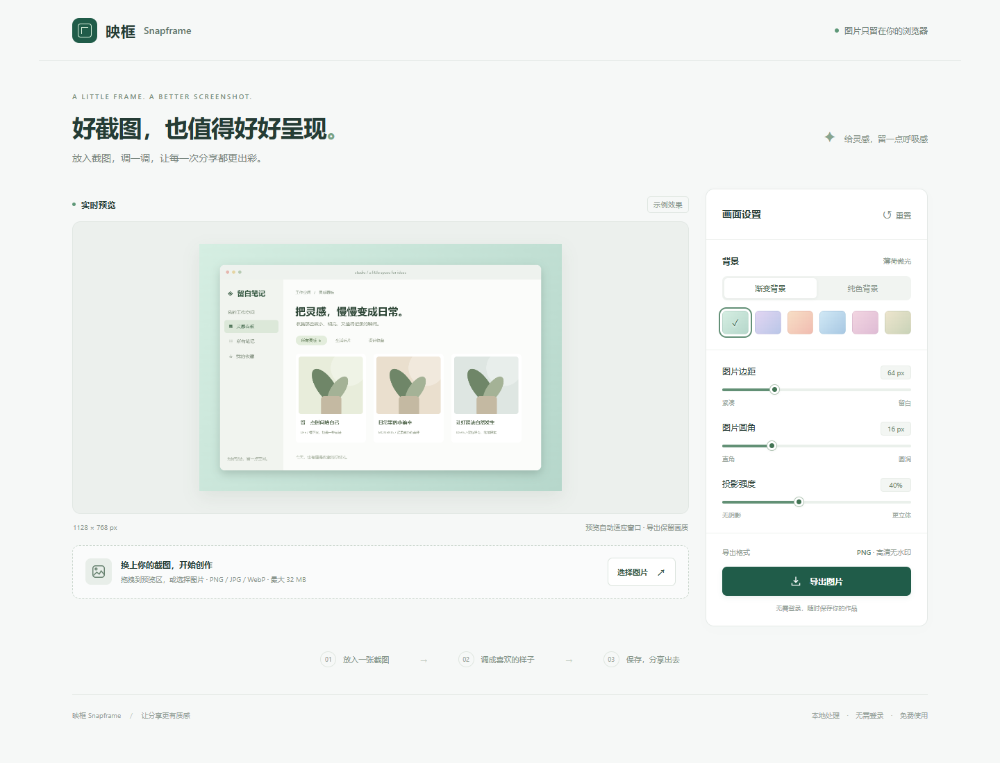

# 映框 Snapframe

给产品截图和教程截图加上干净的背景、留白、圆角与阴影，在浏览器中直接导出 PNG。



> 在线体验：部署尚未完成，当前没有已验证的线上链接。

## 功能

- 选择或拖拽一张 PNG、JPG、WebP 图片。
- 6 款渐变背景、6 款纯色和自定义颜色。
- 调整边距（0–240 px）、圆角（0–64 px）和阴影强度（0–100%）。
- 实时预览，显示导出图片的实际尺寸。
- 导出无水印 PNG；预览与导出使用同一张 Canvas。
- 一键恢复默认样式，同时保留当前截图。
- 中文界面，支持电脑和手机布局。
- 图片仅在当前浏览器内存中处理，无图片上传、账户或分析脚本。

初次打开提供一张本地绘制的示例截图，可直接试用。示例中的“留白笔记”为演示界面。

## 本地运行

安装 [Node.js](https://nodejs.org/) 22 或更新版本。项目没有运行依赖，无需 `npm install`。

```sh
git clone <本仓库的 HTTPS 地址>
cd snapframe
node scripts/serve.mjs
```

打开终端显示的 `http://127.0.0.1:4173`。按 `Ctrl+C` 停止。

构建及预览构建结果：

```sh
node scripts/build.mjs
node scripts/serve.mjs dist
```

也可使用 `npm run dev`、`npm run build` 和 `npm run preview`。请通过本地 HTTP 服务打开，直接双击 HTML 的 `file://` 方式不支持 JavaScript 模块。

## 部署和更新

项目包含 `.github/workflows/deploy.yml`：推送 `main` 后，GitHub Actions 自动检查 JavaScript、构建 `dist/` 并部署到 GitHub Pages。

仓库 Settings → Pages → Build and deployment → Source 应选择 **GitHub Actions**。Actions 中的部署成功后，以部署任务实际返回的链接为准。

所有资源使用相对路径，可部署在 GitHub Pages 的仓库子路径或其他静态托管服务。`dist/version.json` 记录构建所用的提交，便于核实线上版本。

## 验证

已使用 Windows 上的真实 Edge（无头模式）运行端到端检查：

- 文件选择、拖拽，以及 PNG / JPG / WebP 解码。
- 背景和三个参数的画面变化、重置行为。
- 实际下载 PNG，并逐像素比较预览画布与导出文件。
- 6,000 × 4,000 大图的自动缩放和导出。
- 非图片、伪装扩展名、损坏图片、超过 32 MB 文件、多文件和超长图片的错误处理。
- 390 px 与 320 px 手机宽度的布局、调色与导出。
- 浏览器无 JavaScript 错误，无第三方请求或图片上传请求。

实体 iOS / Android、Safari 和 Firefox 尚未实测。

可复现浏览器检查（Python 3.10+，单独的开发依赖）：

```sh
python -m pip install -r tests/requirements.txt
python -m playwright install chromium
# 先在另一个终端启动项目，再运行：
python tests/browser_check.py http://127.0.0.1:4173
```

如果本机安装了 Edge，脚本会直接使用它；否则使用 Playwright Chromium。截图、导出样本和结果写入已忽略的 `test-results/`。

## 默认值与限制

- 默认使用“薄荷微光”渐变，边距 64 px、圆角 16 px、阴影 40%。调节值按源图片像素计算；大图安全缩放时同比缩放。
- 一次处理一张图片，不提供批量编辑、文字标注、裁剪或云端保存。
- 单文件最大 32 MB；输入边长最大 16,384 px、总像素最大 4,000 万。
- 导出保持源图分辨率并加上边距；超过单边 8,192 px 或 1,600 万像素时自动等比例缩小并提示。小内存设备仍可能无法处理接近上限的图片，请先缩小源图。
- 面向静态截图；不支持 SVG、GIF、HEIC、动画导出。输入动画 PNG / WebP 的显示帧不保证固定，请先转换为静态图片。
- 背景始终不透明，导出格式固定为 PNG；低清晰度源图不会自动修复。
- 手机浏览器可能打开导出图片，需要长按保存。实体设备上的保存交互尚未实测。
- 需要支持 ES Modules、Canvas `roundRect` 和 `HTMLImageElement.decode` 的现代浏览器。
- 不保存编辑状态；刷新或关闭页面会丢失当前图片和设置。

## 项目结构

```text
index.html                 中文界面
src/app.js                 上传、控件、状态与下载
src/renderer.js            共用画布绘制和本地示例
src/style.css              响应式样式
scripts/build.mjs          语法检查与静态构建
scripts/serve.mjs          本地开发服务器
tests/browser_check.py     浏览器端到端验证
.github/workflows/         自动部署
```

## 反馈和贡献

欢迎通过本仓库的 Issues 反馈问题，说明浏览器、操作步骤和预期结果；涉及隐私时，请用不含敏感内容的示例图。改进建议和 Pull Request 也很欢迎。提交前请运行构建，并对涉及的上传或导出行为进行浏览器验证。

如果映框让你的截图分享更省心，欢迎点一个 Star，让更多人发现它。

## 开源协议

[MIT](LICENSE)。你可以使用、修改和分发本项目，请保留许可证声明。
